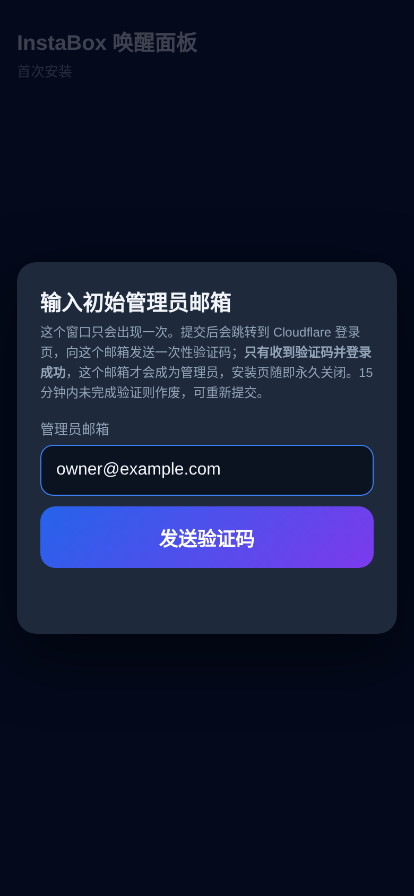

# instabox-waker

一个部署在 Cloudflare Workers 上的 **InstaBox 机器手动唤醒面板**：手机上点一下就能唤醒 / 恢复你的 InstaBox 机器，并能看到状态和倒计时。面板放在 Cloudflare Access（邮箱一次性验证码）后面，Worker 内部再次校验 Access JWT，并且每个请求都会按 Access 策略的当前邮箱列表实时复核。首次打开时有一个**一次性的安装弹窗**，输入你的管理员邮箱并收到验证码登录后，安装页就永久关闭；之后用 `/admin` 管理允许登录的邮箱和管理员。

A Cloudflare Worker that gives you a **one-click, manual wake/resume button for an InstaBox machine**, with live status and countdowns. It sits behind Cloudflare Access (email one-time PIN), verifies the Access JWT itself, and re-checks every request against the policy's current email list. On first use a **one-time setup box** asks for your admin email; once you receive the code and sign in, the setup page is gone for good. After that, `/admin` manages allowed emails and admins.

[中文](#中文) · [English](#english) · 📘 新手教程 [中文](docs/TUTORIAL.zh-CN.md) / [English](docs/TUTORIAL.en.md) · 🤖 AI agent skill: [skills/instabox-waker-deploy/SKILL.md](skills/instabox-waker-deploy/SKILL.md)

| 首次安装 / First-run setup | 唤醒页 / Wake page | 管理员面板 / Admin |
|---|---|---|
|  |  |  |

---

## 中文

### 功能

- **一键唤醒**：`suspended` → resume，`stopped`/`error` → start（都带 `Idempotency-Key`）；已在运行时按钮变为"重置空闲计时"（调用 `/wake` 记录一次活动）。正在进行的操作会显示"唤醒中…"并加快轮询。
- **状态**：运行状态、是否 ready、状态变更时间、本次运行开始时间、规格、休眠阈值，每 10 秒刷新。
- **空闲倒计时（估算）**：InstaBox API 不提供"最后活动时间"，所以从本浏览器最近一次按按钮（或本次运行开始）起按 `autoSuspendAfterSeconds`（默认 30 分钟）估算。
- **最长运行上限倒计时（精确）**：免费版连续运行上限 8 小时（`runStartedAt + maxRunMinutes`），到点会被强制休眠并进入冷却期。
- **一次性安装向导**：`/setup` 弹窗输入初始管理员邮箱 → Cloudflare Access 发验证码 → 登录成功即成为管理员，安装页永久消失；收不到验证码就无法完成。
- **/admin**：查看 / 添加 / 删除允许登录的邮箱，设为 / 取消管理员；删除需二次确认；最多 50 个邮箱；删除后 1 分钟内生效。策略里的非邮箱规则会带警告显示；include 中含非邮箱规则时面板拒绝保存。

### 设计：只手动，不保活

这个 Worker **没有 cron、没有 scheduled handler、不会自动唤醒或保活**。只有在你按下按钮（`POST /api/wake`）时才会调用 InstaBox API 的 resume/start/wake。这是刻意的：免费额度和空闲休眠是 InstaBox 的设计，不应该被后台脚本绕过。`wrangler.toml` 模板里也没有 `[triggers]`，请不要添加。（唯一的 Durable Object 闹钟只用于清理过期的安装邮箱，不会碰你的机器。）

### 部署

**完全没经验？** 按 [新手教程](docs/TUTORIAL.zh-CN.md) 一步步来。**用 AI agent（DeepSeek、Claude Code 等）？** 把 [SKILL.md](skills/instabox-waker-deploy/SKILL.md) 交给它。简要步骤：

1. 准备：Cloudflare 账号 + 托管在 Cloudflare 的域名，开通 Zero Trust（Free），Node.js 18+，`instabox` CLI。`git clone` 本仓库，`npx wrangler login`。
2. **InstaBox key**（建议 90 天过期）：
   ```sh
   instabox ls
   instabox keys create -name instabox-waker -scope machines:read,machines:write -expires-in-days 90
   ```
3. **Access**：用脚本（需要一个临时的 bootstrap API token），或者按教程在面板里点：
   ```sh
   CF_BOOTSTRAP_TOKEN=... node scripts/bootstrap-access.mjs --account <账号ID> --host waker.example.com --create-worker-token
   ```
   它会创建：One-time PIN 登录方式、可复用 Allow 策略（会话 24h）、`waker.example.com` 的 Access 应用（会话 24h、只允许 OTP）、`waker.example.com/setup` 的**临时 bypass 应用**，以及（可选）给 Worker 用的 90 天、只有 Access: Policies 读写权限的 token（写入 `.worker-cf-token`，不打印）。
4. 把输出的 ID 填进 `wrangler.toml`，然后：
   ```sh
   npx wrangler deploy
   npx wrangler secret put INSTABOX_API_KEY          # 粘贴 InstaBox key
   npx wrangler secret put CF_API_TOKEN < .worker-cf-token && rm .worker-cf-token
   openssl rand -hex 24 > .setup-token && chmod 600 .setup-token
   npx wrangler secret put SETUP_TOKEN < .setup-token
   ```
5. **首次安装**：打开 `https://waker.example.com/setup#t=<.setup-token 的内容>`，输入管理员邮箱 → 跳转登录 → 输入验证码 → 自动进入 `/admin`。
6. 收尾：`npx wrangler secret delete SETUP_TOKEN && rm .setup-token`；删除 `/setup` bypass 应用（`node scripts/bootstrap-access.mjs --account <ID> --cleanup-setup <SETUP_ACCESS_APP_ID> --bypass-policy <SETUP_BYPASS_POLICY_ID>` 或在面板里删）；删除 bootstrap token。

### 配置项

| 名称 | 类型 | 说明 |
|---|---|---|
| `INSTABOX_API_KEY` | secret | InstaBox API key（`machines:read` + `machines:write`，建议 90 天过期） |
| `CF_API_TOKEN` | secret | 只含 Access: Policies Read/Write 的 Cloudflare token，用于 /admin、安装和每次请求的实时邮箱复核 |
| `SETUP_TOKEN` | secret（仅首次） | 一次性安装口令，`openssl rand -hex 24` 生成，安装完成后失效，可删除 |
| `WAKER_STATE` | Durable Object | 保存"已安装"标记、管理员列表、待验证邮箱（模板已配置） |
| `INSTABOX_MACHINE_ID` | var | 要唤醒的机器 ID |
| `ACCESS_TEAM_DOMAIN` | var | `your-team.cloudflareaccess.com`（用于拉取 JWKS 和校验 `iss`） |
| `ACCESS_AUD` | var | Access 应用的 AUD Tag（校验 `aud`） |
| `CF_ACCOUNT_ID` | var | Cloudflare 账号 ID |
| `ACCESS_POLICY_ID` | var | 应用所用的可复用 Allow 策略 ID |
| `SETUP_ACCESS_APP_ID` | var（可选） | `/setup` bypass 应用 ID；安装完成后 Worker 会尝试删除它（token 没有应用权限时会提示你手动删） |
| `DISPLAY_TIMEZONE` | var（可选） | 页面时间显示时区，如 `Europe/Berlin`；留空则用浏览器时区 |
| `SERVICE_TOKEN_IDS` | var（可选） | 逗号分隔的 Access service token Client ID，允许这些客户端以**非管理员**身份访问；默认留空 = 拒绝所有 service token |
| `ADMIN_EMAILS` | var（旧版兼容） | 设置后跳过安装向导、直接作为管理员；新部署请留空 |

### 安全模型

- **两层鉴权**：Cloudflare Access 在边缘拦截未登录请求；Worker 再校验 `Cf-Access-Jwt-Assertion`：RS256 签名（团队 JWKS，缓存 1 小时；遇到未知 `kid` 会立即重新拉取一次，最多每 30 秒一次）、`aud`、`iss`，**必须有 `exp`**，并检查 `nbf`（允许 60 秒时钟偏差）。任何校验失败都返回 **404**，不暴露面板存在。请关闭 `workers.dev` 和 preview URL（模板已设置），只通过受 Access 保护的自定义域名访问。
- **每次请求实时复核允许列表**：JWT 有效之后，Worker 还会把 JWT 里的邮箱和 `ACCESS_POLICY_ID` 策略当前的邮箱列表比对（列表缓存约 60 秒，/admin 修改后立即刷新）。不在列表里 → 403。管理员永远放行（防止把自己锁在外面）。如果 Cloudflare API 不可达或 token 失效，非管理员一律 403（**fail closed**）。所以从列表删除某人后，即使他的 Access 会话还没过期，最多约 1 分钟内也会被拒绝。没有邮箱的 service token 默认拒绝，除非 Client ID 列在 `SERVICE_TOKEN_IDS` 里。
- **会话时长**：建议把 Access 应用和策略的会话时长都设为 24 小时。实时复核解决了"删除后旧会话仍可用"的问题，短会话则进一步限制被盗 cookie 的可用时间。
- **首次安装（一次性）**：没有管理员之前，任何已登录用户都只能看到"尚未完成初始化"。`/setup` 只能通过一个路径级 Access *bypass* 应用访问，并且必须提供部署时生成的 `SETUP_TOKEN`（常量时间比较），所以陌生人抢不走安装。提交的邮箱只是"待验证"（15 分钟），并被临时加进允许策略；**只有 Cloudflare Access 为这个邮箱签发的、校验通过的 JWT** 到达时，Worker 才把它设为管理员并永久标记"已完成"，然后尝试删除 bypass 应用。从未验证 = 永远不算完成，过期的邮箱会自动从策略中移除（Durable Object 闹钟 + 重试，未移除前一律拒绝）。完成之后所有 `/setup` 路径永久 404，`SETUP_TOKEN` 失效（建议再 `wrangler secret delete SETUP_TOKEN`）。状态保存在强一致的 Durable Object 中，所有步骤串行执行，没有并发抢占窗口。
- **管理员**：管理员列表存在 Durable Object 里（`ADMIN_EMAILS` 只是旧版兼容的备用项）。/admin 只对管理员开放，否则 403；非管理员仍可用唤醒页。管理员可以把列表里的人设为 / 取消管理员；管理员不能被直接删除（先取消），并且**最后一个管理员不能被取消**。
- **CSRF**：所有写操作（`/api/wake`、`/admin/api/*`）要求自定义请求头 `x-ib-waker: 1`，且 `Origin`（若存在）必须同源；admin 写操作还要求 `Content-Type: application/json`。
- **CSP**：页面没有任何内联脚本或内联样式，JS/CSS 从同源 `/assets/*` 加载（同样在鉴权之后），并发送严格 CSP：`default-src 'none'; script-src 'self'; style-src 'self'; connect-src 'self'; img-src 'self' data:; form-action 'self'; frame-ancestors 'none'; base-uri 'none'`。动态内容只用 `textContent` 渲染。
- **策略里的其他规则**：/admin 会带警告显示所有非邮箱规则（include / exclude / require）；只要 include 里有非邮箱规则（例如 Everyone、邮箱域名、IdP 组），面板就拒绝保存，需要先在 Zero Trust 面板处理。
- **输入校验**：邮箱格式 + 长度校验、去重、上限 50；`?op=` 只接受 `op_[a-z0-9]+`，且只返回 `machineId` 等于 `INSTABOX_MACHINE_ID` 的操作。
- **最小权限（以及它的边界）**：InstaBox key 的 scope 只有 `machines:read` + `machines:write`，但 InstaBox 不支持按机器限制 key，`machines:write` 对账号下**所有**机器都有效（包括 exec/SSH 类操作）。CF token 只有 Access 策略读写，但对整个账号的 Access 策略都有效，泄露后不能动 Worker 或 DNS，却可以改你账号里其他 Access 策略。所以两者都只作为 Worker secret 保存，不进仓库，不在本地留副本，并建议**设置 90 天过期并定期轮换**。
- **响应头**：所有响应带 `Cache-Control: no-store`、`X-Content-Type-Options: nosniff`、`X-Frame-Options: DENY`、`Referrer-Policy: no-referrer` 和上面的 CSP。
- **已知限制**：空闲倒计时是估算值；/admin 的读改写不是原子操作，两个管理员同时修改时后写入的会覆盖先写入的。

### 撤销与轮换

- InstaBox key：`instabox keys ls` 找到 ID 后 `instabox keys rm <id>`。
- CF token：在 API Tokens 页面删除。删除后 /admin 返回 502，**非管理员会被拒绝（fail closed）**，管理员仍可使用唤醒页。
- 轮换：先创建新凭据并 `wrangler secret put`，确认面板正常，再撤销旧凭据。

---

## English

### What it does

- **One-click wake**: `suspended` → resume, `stopped`/`error` → start (with an `Idempotency-Key`). When already running, the button becomes "reset idle timer" (calls `/wake` to record activity). In-flight operations show a busy state and poll faster.
- **Status**: state, readiness, last state change, run start time, spec and idle threshold, refreshed every 10 s.
- **Idle countdown (estimate)**: InstaBox's API doesn't expose last-activity time, so the countdown runs from this browser's last button press (or the run start), using `autoSuspendAfterSeconds` (30 min by default).
- **Max-run countdown (exact)**: the free tier caps a continuous run at 8 hours (`runStartedAt + maxRunMinutes`). After that the machine is force-suspended and a cooldown starts.
- **One-time setup wizard**: `/setup` shows a box asking for the initial admin email → Cloudflare Access emails a code → once you sign in you are the admin and the setup page is gone for good. If the code never arrives, setup can't complete.
- **/admin**: list/add/remove allowed emails and promote/demote admins. Removing someone takes two confirmations, the list is capped at 50, and a removal takes effect within a minute. Non-email policy rules are shown with a warning, and the panel refuses to save while the include list contains anything other than plain email rules.

### Design note: manual only, no keepalive

There is **no cron, no scheduled handler, and no auto-wake or keepalive**. The Worker only calls InstaBox resume/start/wake when you press the button (`POST /api/wake`). This is on purpose: idle suspend and the free-tier limits are part of InstaBox's design, and a background job shouldn't get around them. The `wrangler.toml` template has no `[triggers]`; please keep it that way. (The only Durable Object alarm cleans up an expired setup email and never touches your machine.)

### Setup

**New to all this?** Follow the [beginner tutorial](docs/TUTORIAL.en.md). **Using an AI agent (DeepSeek, Claude Code, …)?** Give it [SKILL.md](skills/instabox-waker-deploy/SKILL.md). The short version:

1. You need a Cloudflare account with a domain on it, Zero Trust (Free) enabled, Node.js 18+ and the `instabox` CLI. `git clone` this repo and run `npx wrangler login`.
2. **InstaBox key** (90-day expiry recommended):
   ```sh
   instabox ls
   instabox keys create -name instabox-waker -scope machines:read,machines:write -expires-in-days 90
   ```
3. **Access**: either run the script (needs a temporary bootstrap API token) or click through the dashboard as the tutorial shows:
   ```sh
   CF_BOOTSTRAP_TOKEN=... node scripts/bootstrap-access.mjs --account <ACCOUNT_ID> --host waker.example.com --create-worker-token
   ```
   It creates the One-time PIN login method, a reusable Allow policy (24 h session), the Access app for `waker.example.com` (24 h session, OTP only), a **temporary bypass app** for `waker.example.com/setup`, and optionally a 90-day Worker token limited to Access: Policies read/write (written to `.worker-cf-token`, never printed).
4. Put the printed IDs into `wrangler.toml`, then:
   ```sh
   npx wrangler deploy
   npx wrangler secret put INSTABOX_API_KEY          # paste the InstaBox key
   npx wrangler secret put CF_API_TOKEN < .worker-cf-token && rm .worker-cf-token
   openssl rand -hex 24 > .setup-token && chmod 600 .setup-token
   npx wrangler secret put SETUP_TOKEN < .setup-token
   ```
5. **First-run setup**: open `https://waker.example.com/setup#t=<contents of .setup-token>`, enter your admin email, sign in with the emailed code, and you land on `/admin`.
6. Clean up: `npx wrangler secret delete SETUP_TOKEN && rm .setup-token`; delete the `/setup` bypass app (`node scripts/bootstrap-access.mjs --account <ID> --cleanup-setup <SETUP_ACCESS_APP_ID> --bypass-policy <SETUP_BYPASS_POLICY_ID>`, or in the dashboard); delete the bootstrap token.

### Configuration

| Name | Kind | Purpose |
|---|---|---|
| `INSTABOX_API_KEY` | secret | InstaBox API key (`machines:read` + `machines:write`, 90-day expiry recommended) |
| `CF_API_TOKEN` | secret | Cloudflare token with Access: Policies Read/Write only, used by `/admin`, setup and the per-request live allow-list check |
| `SETUP_TOKEN` | secret (first run) | One-time setup password from `openssl rand -hex 24`; useless after setup, delete it |
| `WAKER_STATE` | Durable Object | Holds the setup-done flag, the admin list and the pending email (already in the template) |
| `INSTABOX_MACHINE_ID` | var | Machine to wake |
| `ACCESS_TEAM_DOMAIN` | var | `your-team.cloudflareaccess.com` (JWKS URL and `iss` check) |
| `ACCESS_AUD` | var | Access app AUD tag (`aud` check) |
| `CF_ACCOUNT_ID` | var | Cloudflare account ID |
| `ACCESS_POLICY_ID` | var | ID of the reusable Allow policy attached to the app |
| `SETUP_ACCESS_APP_ID` | var (optional) | ID of the `/setup` bypass app; the Worker tries to delete it after setup and tells you to do it by hand if the token lacks app permissions |
| `DISPLAY_TIMEZONE` | var (optional) | IANA time zone for displayed times; empty = the browser's zone |
| `SERVICE_TOKEN_IDS` | var (optional) | Comma-separated Access service-token Client IDs allowed in as **non-admin** clients. Empty by default, which rejects all service tokens |
| `ADMIN_EMAILS` | var (legacy) | If set, skips the setup wizard and makes these emails admins. Leave empty for new installs |

### Security model

- **Two layers of auth**: Cloudflare Access blocks unauthenticated requests at the edge. The Worker then verifies `Cf-Access-Jwt-Assertion` itself: the RS256 signature against the team JWKS (cached for 1 h, and refetched once when an unknown `kid` shows up, at most every 30 s), `aud`, `iss`, a **required** `exp`, and `nbf`, with 60 s of clock skew allowed. Any failure returns **404**, so the panel doesn't reveal that it exists. Keep `workers.dev` and preview URLs disabled (the template does this) so the Access-protected custom domain is the only way in.
- **Live allow-list check on every request**: after the JWT checks out, the Worker compares its email with the current email list of the `ACCESS_POLICY_ID` policy. The list is cached for about 60 s and refreshed right after any `/admin` change. Emails not on the list get a 403. Admins always pass, so you can't lock yourself out. If the Cloudflare API is unreachable or the token is broken, non-admins get a 403 (**fail closed**). So once you remove someone, they're refused within about a minute even if their Access session hasn't expired. Service tokens carry no email and are rejected unless their Client ID is listed in `SERVICE_TOKEN_IDS`.
- **Session length**: set the Access app and policy session duration to 24 hours. The live check closes the "removed user keeps their session" gap, and a short session also limits how long a stolen cookie stays useful.
- **First-run setup (one time only)**: until there is an admin, every signed-in user just sees "setup not finished". `/setup` is reachable only through a path-scoped Access *bypass* app and requires the `SETUP_TOKEN` generated at deploy time (compared in constant time), so a stranger can't race you to claim the panel. The email you submit is only *pending* for 15 minutes and is temporarily added to the allow policy. **Only when an Access-verified JWT for exactly that email arrives** does the Worker make it the admin, permanently mark setup as done, and try to delete the bypass app. Never verified means never done, and expired emails are removed from the policy automatically (a Durable Object alarm with retries; they are denied until removed). After setup every `/setup` URL is a permanent 404 and `SETUP_TOKEN` is useless (delete it anyway with `wrangler secret delete SETUP_TOKEN`). State lives in a strongly consistent Durable Object and every step is serialized, so there is no race window.
- **Admins**: the admin list lives in the Durable Object (`ADMIN_EMAILS` is only a legacy fallback). `/admin` is for admins only, otherwise 403. Everyone else can still use the wake page. Admins can promote or demote people on the list. An admin can't be deleted directly (demote first), and **the last admin can't be demoted**.
- **CSRF**: every write (`/api/wake`, `/admin/api/*`) requires the custom header `x-ib-waker: 1` and a same-origin `Origin` when one is present. Admin writes also require `Content-Type: application/json`.
- **CSP**: the pages have no inline script or style. JS and CSS load from same-origin `/assets/*`, which is also behind auth, and every response carries a strict CSP: `default-src 'none'; script-src 'self'; style-src 'self'; connect-src 'self'; img-src 'self' data:; form-action 'self'; frame-ancestors 'none'; base-uri 'none'`. Dynamic content is rendered with `textContent` only.
- **Other policy rules**: `/admin` shows every non-email rule (include, exclude, require) with a warning. While the include list has any non-email rule (Everyone, an email domain, an IdP group, …), the panel refuses to save; fix it in the Zero Trust dashboard first.
- **Input validation**: email format and length checks, de-duplication, and a 50-entry cap. `?op=` accepts only `op_[a-z0-9]+` and reports an operation only if its `machineId` matches `INSTABOX_MACHINE_ID`.
- **Least privilege, and where it stops**: the InstaBox key has only `machines:read` + `machines:write`. InstaBox can't scope a key to one machine, so `machines:write` covers **every** machine in the account, exec/SSH-style actions included. The CF token can only read and write Access policies, but it covers every Access policy in the account. A leak can't touch Workers or DNS, but it could change your other Access policies. Keep both only as Worker secrets: never commit them, don't keep local copies, and **set a 90-day expiry and rotate them**.
- **Headers**: every response sends `Cache-Control: no-store`, `X-Content-Type-Options: nosniff`, `X-Frame-Options: DENY`, `Referrer-Policy: no-referrer` and the CSP above.
- **Known limits**: the idle countdown is an estimate. `/admin` edits are read-modify-write, so if two admins save at the same moment, the later write wins.

### Revoking and rotating

- InstaBox key: `instabox keys ls`, then `instabox keys rm <id>`.
- CF token: delete it on the API Tokens page. `/admin` will then return 502 and **non-admins are refused (fail closed)**; admins can still use the wake page.
- Rotation: create the new credential, `wrangler secret put` it, check the panel works, then revoke the old one.

## License

MIT © 2026 instabox-waker contributors
