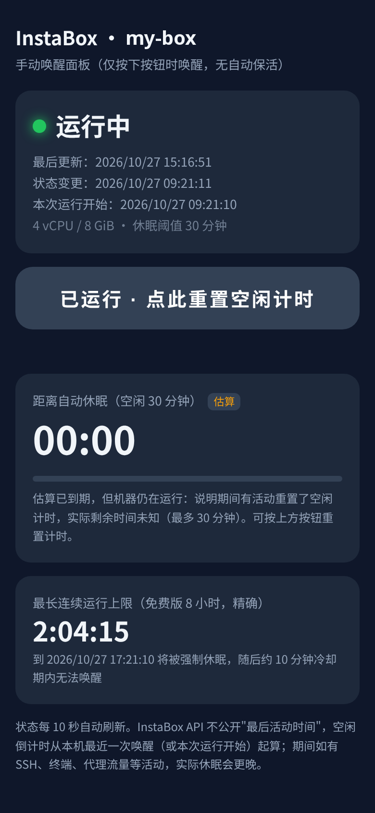
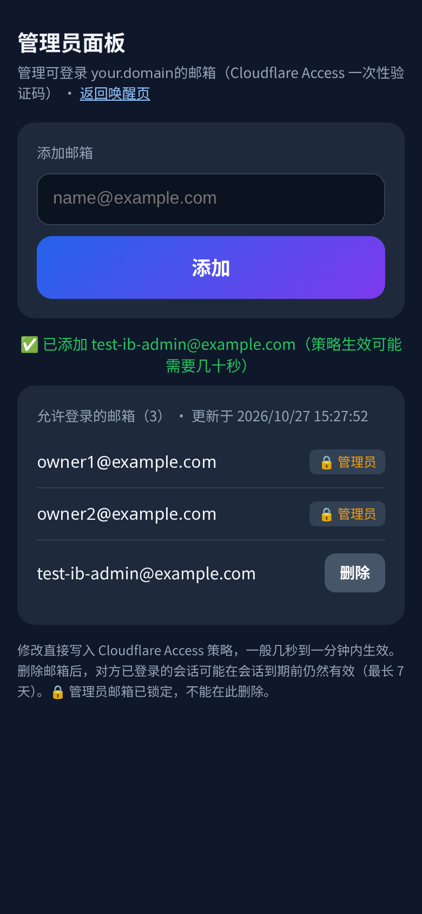

# instabox-waker

一个部署在 Cloudflare Workers 上的 **InstaBox 机器手动唤醒面板**：手机上点一下就能唤醒 / 恢复你的 InstaBox 机器，并能看到状态和倒计时。面板放在 Cloudflare Access（邮箱一次性验证码）后面，Worker 内部再次校验 Access JWT；另带一个 `/admin` 页面，用权限极小的 Cloudflare API token 管理允许登录的邮箱。

A Cloudflare Worker that gives you a **one-click, manual wake/resume button for an InstaBox machine**, with live status and countdowns. It sits behind Cloudflare Access (email one-time PIN), verifies the Access JWT itself, and has an `/admin` page that edits the allowed-email list of the Access policy through a narrowly scoped Cloudflare API token.

[中文](#中文) · [English](#english)

| 唤醒页 / Wake page | 管理员面板 / Admin |
|---|---|
|  |  |

---

## 中文

### 功能

- **一键唤醒**：`suspended` → resume，`stopped`/`error` → start（都带 `Idempotency-Key`）；已在运行时按钮变为"重置空闲计时"（调用 `/wake` 记录一次活动）。正在进行的操作会显示"唤醒中…"并加快轮询。
- **状态**：运行状态、是否 ready、状态变更时间、本次运行开始时间、规格、休眠阈值，每 10 秒刷新。
- **空闲倒计时（估算）**：InstaBox API 不提供"最后活动时间"，所以从本浏览器最近一次按按钮（或本次运行开始）起按 `autoSuspendAfterSeconds`（默认 30 分钟）估算。
- **最长运行上限倒计时（精确）**：免费版连续运行上限 8 小时（`runStartedAt + maxRunMinutes`），到点会被强制休眠并进入冷却期。
- **/admin**：查看 / 添加 / 删除 Access 策略中允许登录的邮箱；`ADMIN_EMAILS` 里的邮箱锁定不可删除；删除需二次确认；最多 50 个邮箱；策略里非邮箱类型的 include 规则原样保留。

### 设计：只手动，不保活

这个 Worker **没有 cron、没有 scheduled handler、不会自动唤醒或保活**。只有在你按下按钮（`POST /api/wake`）时才会调用 InstaBox API 的 resume/start/wake。这是刻意的：免费额度和空闲休眠是 InstaBox 的设计，不应该被后台脚本绕过；需要用时手动叫醒即可。`wrangler.toml` 模板里也没有 `[triggers]`，请不要添加。

### 部署步骤

前提：一个托管在 Cloudflare 的域名、已开通 Cloudflare Zero Trust（免费版即可）、已安装 `wrangler` 和 `instabox` CLI。

1. **创建 InstaBox API key**（只给机器读写权限）：
   ```sh
   instabox ls                      # 找到机器 ID（m_ 开头）
   instabox keys create -name instabox-waker -scope machines:read,machines:write
   ```
   记下打印出的 key（只显示一次）。可加 `-expires-in-days 90` 设置过期。

2. **创建 Cloudflare Access 应用 + 邮箱 OTP**（Zero Trust 面板）：
   - Settings → Authentication → Login methods：启用 **One-time PIN**。
   - Access → Policies：新建一个**可复用策略**，Action = Allow，Include = Emails，填入你的邮箱。记下策略 ID（URL 或 API 中可见）。
   - Access → Applications → Add → Self-hosted：域名填你要用的子域名（如 `waker.example.com`），挂上上面的策略，登录方式只选 One-time PIN。
   - 在应用的 Overview 里复制 **Application Audience (AUD) Tag**；团队域名形如 `your-team.cloudflareaccess.com`。

3. **创建权限最小的 Cloudflare API token**（只有 /admin 需要）：
   My Profile → API Tokens（或 Manage Account → Account API Tokens）→ Create Custom Token：
   - 权限只给 **Account → Access: Policies → Read** 和 **Account → Access: Policies → Edit/Write**；
   - Account Resources 只选你这个账号；不要加任何 Zone / Workers / DNS 权限。
   - 可选：设置 IP 过滤、过期时间。

4. **填写 `wrangler.toml`**：`routes` 里的域名，以及 `[vars]` 中的 `INSTABOX_MACHINE_ID`、`ACCESS_TEAM_DOMAIN`、`ACCESS_AUD`、`ADMIN_EMAILS`、`CF_ACCOUNT_ID`、`ACCESS_POLICY_ID`（可选 `DISPLAY_TIMEZONE`）。

5. **写入 secret 并部署**：
   ```sh
   wrangler secret put INSTABOX_API_KEY
   wrangler secret put CF_API_TOKEN
   wrangler deploy
   ```
   打开 `https://waker.example.com/`，用邮箱验证码登录即可。

### 配置项

| 名称 | 类型 | 说明 |
|---|---|---|
| `INSTABOX_API_KEY` | secret | InstaBox API key（`machines:read` + `machines:write`） |
| `CF_API_TOKEN` | secret | 只含 Access: Policies Read/Write 的 Cloudflare token，仅 /admin 使用 |
| `INSTABOX_MACHINE_ID` | var | 要唤醒的机器 ID |
| `ACCESS_TEAM_DOMAIN` | var | `your-team.cloudflareaccess.com`（用于拉取 JWKS 和校验 `iss`） |
| `ACCESS_AUD` | var | Access 应用的 AUD Tag（校验 `aud`） |
| `ADMIN_EMAILS` | var | 逗号分隔的管理员邮箱：可进 /admin，且不能被删除 |
| `CF_ACCOUNT_ID` | var | Cloudflare 账号 ID |
| `ACCESS_POLICY_ID` | var | 应用所用的可复用 Allow 策略 ID |
| `DISPLAY_TIMEZONE` | var（可选） | 页面时间显示时区，如 `Asia/Shanghai`；留空则用浏览器时区 |

### 安全模型

- **两层鉴权**：Cloudflare Access 在边缘拦截未登录请求；Worker 再校验 `Cf-Access-Jwt-Assertion`：RS256 签名（团队 JWKS，缓存 1 小时）、`aud`、`iss`、`exp`。任何校验失败都返回 **404**，不暴露面板存在。请关闭 `workers.dev` 和 preview URL（模板已设置），只通过受 Access 保护的自定义域名访问。
- **管理员**：/admin 只对 JWT 中 `email` 属于 `ADMIN_EMAILS` 的用户开放，否则 403；非管理员仍可用唤醒页。管理员邮箱在后端锁定，不能通过 API 删除（防止把自己锁在外面）。
- **CSRF**：所有写操作（`/api/wake`、`/admin/api/*`）要求自定义请求头 `x-ib-waker: 1`，且 `Origin`（若存在）必须同源；admin 写操作还要求 `Content-Type: application/json`。
- **输入校验**：邮箱格式 + 长度校验、去重、上限 50；操作 ID 只接受 `op_[a-z0-9]+`。
- **最小权限**：InstaBox key 只有机器读写；CF token 只有 Access 策略读写，泄露后最多能改 Access 策略，不能动 Worker、DNS 或其他资源。两个凭据都只作为 Worker secret 保存，不进仓库。
- **响应头**：HTML 页面带 `X-Frame-Options: DENY`、`Referrer-Policy: no-referrer`，所有响应 `Cache-Control: no-store`。
- **已知限制**：从列表删除某个邮箱后，此人已有的 Access 会话在到期前仍然有效；需要立即踢出可在 Zero Trust → Access → Applications → Revoke existing tokens。空闲倒计时是估算值。

### 撤销

- InstaBox key：`instabox keys ls` 找到 ID 后 `instabox keys rm <id>`。
- CF token：在 API Tokens 页面删除；删除后 /admin 会返回 502，唤醒页不受影响。

---

## English

### What it does

- **One-click wake**: `suspended` → resume, `stopped`/`error` → start (with an `Idempotency-Key`). When already running, the button becomes "reset idle timer" (calls `/wake` to record activity). In-flight operations show a busy state and poll faster.
- **Status**: state, readiness, last state change, run start time, spec and idle threshold, refreshed every 10 s.
- **Idle countdown (estimate)**: InstaBox's API doesn't expose last-activity time, so the countdown runs from this browser's last button press (or the run start), using `autoSuspendAfterSeconds` (30 min by default).
- **Max-run countdown (exact)**: the free tier caps a continuous run at 8 hours (`runStartedAt + maxRunMinutes`). After that the machine is force-suspended and a cooldown starts.
- **/admin**: list/add/remove emails in the Access policy's include list. Emails in `ADMIN_EMAILS` are locked. Removing one takes two confirmations, the list is capped at 50, and non-email include rules are kept as they are.

### Design note: manual only, no keepalive

There is **no cron, no scheduled handler, and no auto-wake or keepalive**. The Worker only calls InstaBox resume/start/wake when you press the button (`POST /api/wake`). This is on purpose: idle suspend and the free-tier limits are part of InstaBox's design, and a background job shouldn't get around them. The `wrangler.toml` template has no `[triggers]`. Please keep it that way.

### Setup

Prerequisites: a domain on Cloudflare, Cloudflare Zero Trust (the free plan works), and the `wrangler` and `instabox` CLIs.

1. **InstaBox API key** (machine read/write only):
   ```sh
   instabox ls                      # find your machine ID (starts with m_)
   instabox keys create -name instabox-waker -scope machines:read,machines:write
   ```
   Save the printed key; it's only shown once. Add `-expires-in-days 90` if you want it to expire.
2. **Access application + email OTP** (Zero Trust dashboard):
   - Settings → Authentication → Login methods: enable **One-time PIN**.
   - Access → Policies: create a **reusable** policy with Action = Allow and Include = Emails (your address). Note its policy ID.
   - Access → Applications → Add → Self-hosted: use your hostname (e.g. `waker.example.com`), attach that policy, and allow only One-time PIN.
   - Copy the **Application Audience (AUD) Tag** from the app's Overview. Your team domain looks like `your-team.cloudflareaccess.com`.
3. **Scoped Cloudflare API token** (only `/admin` needs it): create a custom token with **only** *Account → Access: Policies → Read* and *Account → Access: Policies → Edit/Write*, limited to your account. Don't give it any Zone, Workers or DNS permissions. Optionally add IP filtering or a TTL.
4. **Fill in `wrangler.toml`**: the route hostname and the `[vars]` listed below.
5. **Secrets and deploy**:
   ```sh
   wrangler secret put INSTABOX_API_KEY
   wrangler secret put CF_API_TOKEN
   wrangler deploy
   ```
   Open `https://waker.example.com/` and sign in with the email code.

### Configuration

| Name | Kind | Purpose |
|---|---|---|
| `INSTABOX_API_KEY` | secret | InstaBox API key (`machines:read` + `machines:write`) |
| `CF_API_TOKEN` | secret | Cloudflare token with Access: Policies Read/Write only, used by `/admin` |
| `INSTABOX_MACHINE_ID` | var | Machine to wake |
| `ACCESS_TEAM_DOMAIN` | var | `your-team.cloudflareaccess.com` (JWKS URL and `iss` check) |
| `ACCESS_AUD` | var | Access app AUD tag (`aud` check) |
| `ADMIN_EMAILS` | var | Comma-separated admin emails: can open `/admin`, can't be removed |
| `CF_ACCOUNT_ID` | var | Cloudflare account ID |
| `ACCESS_POLICY_ID` | var | ID of the reusable Allow policy attached to the app |
| `DISPLAY_TIMEZONE` | var (optional) | IANA time zone for displayed times; empty = the browser's zone |

### Security model

- **Two layers of auth**: Cloudflare Access blocks unauthenticated requests at the edge. The Worker then verifies `Cf-Access-Jwt-Assertion` itself: the RS256 signature against the team JWKS (cached for 1 h), plus `aud`, `iss` and `exp`. Any failure returns **404**, so the panel doesn't reveal that it exists. Keep `workers.dev` and preview URLs disabled (the template does this) so the Access-protected custom domain is the only way in.
- **Admins**: `/admin` requires the JWT `email` to be listed in `ADMIN_EMAILS`, otherwise it returns 403. Everyone else can still use the wake page. Admin emails are locked on the server side so you can't remove yourself.
- **CSRF**: every write (`/api/wake`, `/admin/api/*`) requires the custom header `x-ib-waker: 1` and a same-origin `Origin` when one is present. Admin writes also require `Content-Type: application/json`.
- **Input validation**: email format and length checks, de-duplication, a 50-entry cap, and operation IDs restricted to `op_[a-z0-9]+`.
- **Least privilege**: the InstaBox key can only read and write machines. The CF token can only read and write Access policies, so a leak can't touch Workers, DNS or anything else. Both live only as Worker secrets and are never committed.
- **Headers**: HTML pages send `X-Frame-Options: DENY` and `Referrer-Policy: no-referrer`, and every response sends `Cache-Control: no-store`.
- **Known limits**: removing an email doesn't end that person's existing Access session until it expires. To cut them off right away, use Zero Trust → Access → Applications → Revoke existing tokens. The idle countdown is an estimate.

### Revoking

- InstaBox key: `instabox keys ls`, then `instabox keys rm <id>`.
- CF token: delete it on the API Tokens page. `/admin` will then return 502; the wake page keeps working.

## License

MIT © 2026 x t
